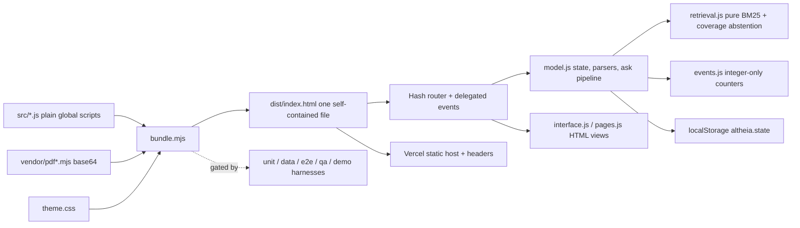

# Aletheia — engineering closeout / release report

Date: 2026-11-26 (UTC). Classification: **DEMO READY**.

This report records commands and their exact output. Nothing in it is a user,
usage, revenue, performance or clinical claim. See `PILOT_HANDOFF.md` for the
human-only work that remains.

## 1. Classification and rationale

**DEMO READY**, not RELEASE READY and not BLOCKED. The static application, its
verification gates and its documentation are reproducible and internally
consistent; no known P0 defect remains. It is not a releasable clinical product:
there has been no real-user validation, no accuracy bar agreed, no access
control or encryption at rest, and no CSP. The production site is a public
demonstration of a fictional corpus, exactly as the README states.

## 2. Baseline (before changes)

| Check | Exact result |
|---|---|
| Working tree | `git status --porcelain=v1` clean; local `main` = `origin/main` = `9ca85e98a038372715acdb481162698e368cd6a6`; no open PRs |
| `.\verify.cmd` | UNIT 39/39; CHECK passed (39 questions, 22 passages, 334 used keys of 436); LINT passed (10 sources, 2 vendor hashes); EVAL 50/72 (69.4%); bundle 2638 KB; E2E 13/13 |
| CI | runs `45754222575` and `45754459287` success; earlier `45753969933` failed at lint and stopped the release |
| Production | `vercel ls --prod --json`: deployment `dpl_DXQxs41c5qaAu3Ji8zG6beVtRzbP`, target production, `readyState: READY`, `githubCommitSha = 9ca85e98…`, aliases include `aletheia-nine-iota.vercel.app` |
| Dependencies | `npm.cmd audit --json` → 0 vulnerabilities (3 packages, dev-only Playwright) |
| Credentials | tracked-file secret scan → no matches; `.env.local` is ignored (`git check-ignore` confirms) |

Reconciliation: local HEAD, remote `main` and the live production deployment
all pointed at `9ca85e9…` at baseline. Documentation was treated as a claim,
not evidence: the README asserted DOCX/XLSX/PDF upload support, but no test had
ever driven those parsers.

## 3. Defect classification

| Severity | Item | Outcome |
|---|---|---|
| **P0** | Six `[\s\VIEW]` regexes in `src/model.js` (lines ~246, 249, 258, 260, 320, 337) silently broke DOCX, XLSX and text-PDF parsing. | Fixed to `[\s\S]`; lint guard added; 19 synthetic-fixture checks prove it. |
| P1 | Parser and workflow claims were untested; CI gapped on browser workflows. | `data.mjs`, `qa.mjs` added to `check.mjs`, `verify.cmd` and CI. |
| P2 | Demo capture was non-deterministic on the analytics page (relative timestamps). | `demo.mjs` freezes the browser clock; two runs produce identical hashes. |
| Deferred | P1-1 accuracy floor, M1-1 audit CSV, M2-3 Windows CI, full WCAG audit, product licence decisions. | Documented in `plan/backlog.md`; no P0 deferred. |

## 4. Changes in this closeout

- `src/model.js`: corrected six any-character regexes; this restores the
  documented DOCX/XLSX/text-PDF capability.
- `lint.mjs`: rejects reintroduction of `[\\s\\VIEW]`.
- `data.mjs`: new data-layer harness with a minimal in-test ZIP writer and
  synthetic, non-sensitive TXT/CSV/DOCX/XLSX/PDF fixtures.
- `qa.mjs`: new workflow harness — mobile viewport, drawer geometry, quick-find
  keyboard and ARIA, gap-tab keyboard, empty/long/hostile input, network
  failure, persistence and four empty states.
- `demo.mjs`: new deterministic capture (frozen clock, fixed viewport/locale,
  six screenshots plus an integer-only event snapshot).
- `check.mjs`, `verify.cmd`, `package.json`, CI: all new suites wired into the
  release gate.
- Docs: README, CONTRIBUTING, SECURITY, CHANGELOG and plan records reconciled
  with verified behaviour; this report added.

Implementation commit for these changes: `be8426a` (parent `9ca85e9`). The
final documentation commit is recorded in git history, not self-referenced here.

## 5. Verification matrix

| Command | Exact result |
|---|---|
| `node data.mjs` (before fix) | `DATA FAILED — 9 passed, 10 failed` (`sop.docx -> failed / nochunks`, `formulary.xlsx -> failed / nochunks`, `note.pdf -> failed / pdftext`) |
| `node data.mjs` (after fix) | `DATA PASSED — 19 passed, 0 failed` |
| `node qa.mjs` | `QA PASSED — 23 passed, 0 failed` |
| `node demo.mjs` (twice) | `DEMO PASSED — 6 screenshots + content-free event snapshot`; all 7 artifact SHA-256 values identical across both runs |
| `.\verify.cmd` | UNIT 39/39; DATA 19/19; `CHECK PASSED — bundle built, 39 questions, 22 passages, 334 literal t() keys used of 436 defined strings verified`; `LINT PASSED — 10 source files parsed, … 2 pinned vendor hashes verified`; `EVAL PASSED — 50/72 (69.4%) at threshold 0.6, minimum 0.694`; `built 2638 KB`; `E2E PASSED — root + subpath, zero console errors`; `QA PASSED — 23 passed, 0 failed`; exit 0 |
| `npm.cmd audit --json` | `"total": 0` for info/low/moderate/high/critical; 3 packages |
| `Get-FileHash dist/index.html` | `5C87CD090385C26E94C100E9E57009012B2BB7EDF7D9F847520FB1D28B67BCE5` (local checkout; Vercel's Linux checkout embeds LF-normalised pdf.js blobs, so production bytes differ but are functionally identical) |

A successful build is evidence that the build works, not that the product is
fit for clinical use. No usage, user or revenue metric was measured.

## 6. Reproducible demonstration (synthetic data)

```bash
npm ci
node bundle.mjs
node demo.mjs
```

The demo uses only the fictional **Asklepia Diagnostics** corpus shipped in
`src/corpus.js` — no patient, user or confidential data. It writes to
`artifacts/demo/`:

| Artifact | SHA-256 (both runs) |
|---|---|
| `01-landing.png` | `65C214EC2777F10940627F65EB12295452801F39479976E590C5E91F84B9442C` |
| `02-dashboard.png` | `2DAC0C773F23114818081ED9AE3D890D63F19A2E00DD534A5C66F31B4BD87BED` |
| `03-answer.png` | `02FA39F40F53EC82D551E56FDF0F0629BF632313DC8011313C89352220F7B78D` |
| `04-citation.png` | `375B18A3798B1E66D820D00AEDFE4A5D4247A6FF42E84581AECDA39F4DFCCCEA` |
| `05-gaps.png` | `F1AE849EF90967F8A7471FDE62C85DCFEE6406E93D5C888B1E27BD3E0F305252` |
| `06-analytics.png` | `89C85A1306559C581928F342A47569172E1E5864205DE9CE44290853745F53B8` |
| `events.json` | `6AAF359D9ABB15B3BC3E784E54EB49ACFF11C0542E26311BED8C057663130AC3` |

`events.json` contains only `{"ask_started":1,"answer_shown":1,"citation_opened":1}`.
A video can be cut from these frames without re-running the app.

## 7. Architecture



Data flow: a question is resolved either from curated demo Q&A or through
`Retrieval.search()`; evidence chunks are rendered as numbered citations that
open the exact highlighted passage. If coverage is below the threshold the
answer is withheld and a gap is recorded locally. Uploaded files are parsed in
the browser; no runtime dependency is shipped. The optional *Real backend*
setting is the only path that sends a question off-device. Why no framework: a
single static file opens on a ward workstation, hosts behind an intranet, and
keeps the retriever portable.

## 8. Three evidence-based CV bullets

- Built a zero-dependency, trilingual (EN/RU/KK) client-side evidence desk with BM25 retrieval, coverage-based abstention and cited extractive answers in one 2.6 MB static page; verified against a 39-question curated corpus and a 50/72 indicative validation set.
- Found and fixed a silent DOCX/XLSX/PDF parser regression using synthetic fixtures, then converted documented behaviour into 19 data-layer and 23 browser workflow checks that gate CI on every push.
- Shipped a reproducible release pipeline with pinned vendor hashes, clean-install and dependency audits, deterministic screenshot capture, and explicit reconciliation of local HEAD, GitHub `main` and the Vercel production commit.

## 9. Recovery and maintenance

- **Restore user data:** in the browser console,
  `localStorage.setItem('altheia.state', <saved json>)` then reload. Backup is
  `copy(localStorage.getItem('altheia.state'))`. Original uploaded files are
  not stored, only extracted passages — a backup cannot restore the files.
- **Reset:** Settings → *Clear local data* empties history, gaps, uploads and
  settings; `resetAll()` in `src/controller.js` implements it.
- **Roll back production:** identify a prior deployment with
  `npx vercel ls --prod --json` (for example the deployment for `2a90b4d`), then
  `npx vercel rollback <deployment-url>`. This is a public production change and
  requires explicit authorization; it was not performed here.
- **Recover a bad source commit:** `git revert <sha>` locally, rebuild with
  `node bundle.mjs`, run `.\verify.cmd`, then push only after authorization.
- **Upgrade dependencies:** `npm ci && npm audit --json`, then `.\verify.cmd`.
  Playwright browsers are external cache state (`npx playwright install chromium`).
- **Upgrade vendored pdf.js:** replace both `vendor/` files, recompute the
  LF-normalised SHA-256 values, update `lint.mjs` and `THIRD_PARTY_NOTICES`, and
  run `node lint.mjs` and `node data.mjs`.
- **Diagnose CI:** `gh run list --repo yermukhamed0777/aletheia` then
  `gh run view <id> --log-failed`. Known pitfall: Windows checks out CRLF and
  Linux LF, so vendor hashes are computed over LF-normalised bytes.
- **Credentials:** no secret is tracked; `.env*` is ignored. Rotate local Vercel
  CLI tokens you no longer need. Never commit `.env.local`.

## 10. Unresolved risks and human-only items

Human only: recruit/consent pilot participants, approve a de-identified corpus
and protocol, run the seven-day pilot, decide go/no-go, choose deployment
posture and licence, decide on a design partner, and authorize public pushes.
Optional next: P1-1 (raise the eval floor only after a measured improvement),
M1-1 (audit CSV schema + gap export), M2-3 (Windows CI runner), a full WCAG
audit, and the licence/commercial decisions.

Residual risks: no real-user validation; 69.4% on small indicative sets is a
regression floor, not a quality bar; no auth, encryption at rest or CSP;
question text and uploaded passages persist unencrypted in `localStorage`;
LLM/embeddings/OCR are not connected; the Vercel project is tied to a personal
account slug; GitHub Actions v4 emit a non-blocking Node 20 deprecation
annotation. None of these is hidden by this report.

## 11. Post-authorization release verification

After explicit authorization, `git push origin main` moved
`9ca85e9..3e69de9 main -> main`.

- CI run `45775110231` (job `139756776408`): **success in 34s**. Every step
  passed: install dev dependencies, install Chromium, smoke check (with unit),
  source lint, validation eval, fast unit harness, data-layer parsers, build,
  browser smoke (root + subpath), workflow QA and artifact upload. Only
  annotation: actions v4 target Node 20 and are forced to Node 24.
- `vercel ls --prod --json` → first deployment `githubCommitSha`
  `3e69de93686fa130b1098b86ac142bbff7505d53`, `state: READY`, URL
  `aletheia-hvhmc4qv3-erm1ham3d2204-2491.vercel.app`.
- `vercel inspect` → deployment id `dpl_BRLeARkC9QKhq9fEVRg4toFU4KpV`,
  `target: production`, `readyState: READY`, build `bld_elvovf2wv`.
- `curl.exe -sSI https://aletheia-nine-iota.vercel.app/` → `HTTP/1.1 200 OK`,
  `Content-Length: 2743574`, `Etag: "1fa86cfc65f862052c1672ccfe835aac"`,
  `X-Content-Type-Options: nosniff`, `Referrer-Policy: no-referrer`,
  `X-Frame-Options: DENY`.
- Downloaded live HTML: contains `[\s\S]` and contains no `[\VIEW]`, confirming
  the parser fix is the code actually served.

## 12. Subsequent retrieval evaluation (research closeout)

After this release report, the P1-1 retrieval task was completed in commit
`3f27fc2` and documented in `RESEARCH_REPORT.md`. The measured gate moved from
50/72 to 67/72 (answers 43/48, expected abstentions unchanged at 24/24) via a
pruned non-evidence stopword set plus a curated refusal layer; the retrieval
threshold remained 0.6 and no expected answer was edited. The full suite was
re-run: unit 48/48, data 19/19, check passed, lint passed, eval 67/72 with
`EVAL_MIN=0.9305`, bundle 2639 KB, e2e 13/13, QA 24/24. This is a research
prototype benchmark on the fictional Asklepia Diagnostics corpus, not clinical
validation and not a new product release. Section 13 records independent
verification that production serves this code.

## 13. Retrieval benchmark deployment verification (post-report)

Independently verified on 2026-11-28 (UTC) against
`https://aletheia-nine-iota.vercel.app/`. Production serves the retrieval
behaviour introduced in `3f27fc2`. The commit attribution is **artefact-based**,
not a Vercel API deployment record: the local `VERCEL_OIDC_TOKEN` returned HTTP
403 from `api.vercel.com/v6/deployments`, and no authenticated Vercel CLI
session was available. Commands and exact results:

| Command | Result |
|---|---|
| `curl.exe -sS -D - -o "$env:TEMP\opencode\aletheia-live.html" https://aletheia-nine-iota.vercel.app/` | `HTTP/1.1 200 OK`, `Content-Length: 2744904`, `Etag: "9f51aab4063d55f6d08e0dfa87b6bf02"`, `Last-Modified: Thu, 26 Nov 2026 09:07:42 GMT`, `X-Vercel-Cache: HIT`, `X-Vercel-Id: sfo1::z4s77-1795860498257-25a82036e1cd`, `Date: Sat, 28 Nov 2026 10:08:18 GMT` |
| `git archive -o <tmp>\aletheia-3f27fc2.tar 3f27fc2`; `tar.exe -xf <tmp>\aletheia-3f27fc2.tar -C <tmp>\aletheia-3f27fc2`; LF-normalise the Windows-checkout text files; `node <tmp>\aletheia-3f27fc2\bundle.mjs`; `Get-FileHash` on both HTML files | `built 2638 KB`; live HTML and the build of `3f27fc2` both have SHA-256 `3774871868ABB2A5009D148B3E9BB0DC74418134D4B1DA56379412624B329589`. `Last-Modified` is 93 s after commit `3f27fc2` (17:06:09 +0800 = 09:06:09 UTC). |
| Node string probe of the downloaded HTML | Pruned `STOP` additions, `связаться`/`контакты → контакт` canonical mapping, curated `matchCurated(...abstain)` safety layer and `[\s\S]` all present; `[\VIEW]` absent. |
| Playwright against the live URL (temporary script outside the repo) | `HTTP 200` and `LIVE BEHAVIOUR PASSED — 4/4 checks`, zero browser errors: `How often is renal function checked on vancomycin?` → answer contains `48` (a baseline stopword failure); `What is the metformin dose for children?` → `Cannot verify`; `Как связаться с хелпдеском?` → `Cannot verify` with no `08:00`; `When is the lab helpdesk open?` → `08:00` control answer. |
| `node check.mjs` (documentation gate after review) | `CHECK PASSED — bundle built, 39 questions, 22 passages, 334 literal t() keys used of 436 defined strings verified` (UNIT 48/48, DATA 19/19) |
| `cmd /c verify.cmd` (full gate after review) | `EVAL PASSED — 67/72 (93.1%) at threshold 0.6, minimum 0.9305`; `E2E PASSED — root + subpath, zero console errors`; `QA PASSED — 24 passed, 0 failed`; all steps exited 0. |

The 67/72 result (93.1% at threshold 0.6, `EVAL_MIN=0.9305`) is a research
prototype benchmark on the **fictional Asklepia Diagnostics corpus**, not
clinical validation: no real-user validation, no agreed accuracy bar, no access
control or encryption at rest, and no CSP. The parser-fix release candidate
`3e69de9` remains the SHA for the earlier baseline; the retrieval-improved
deployment is a separate research artefact. Documentation-only commits pushed
after the `3e69de9` verification and before the retrieval change rebuilt the
same static artefact and may have changed the reported deployment id; the
source of that release candidate did not change.
